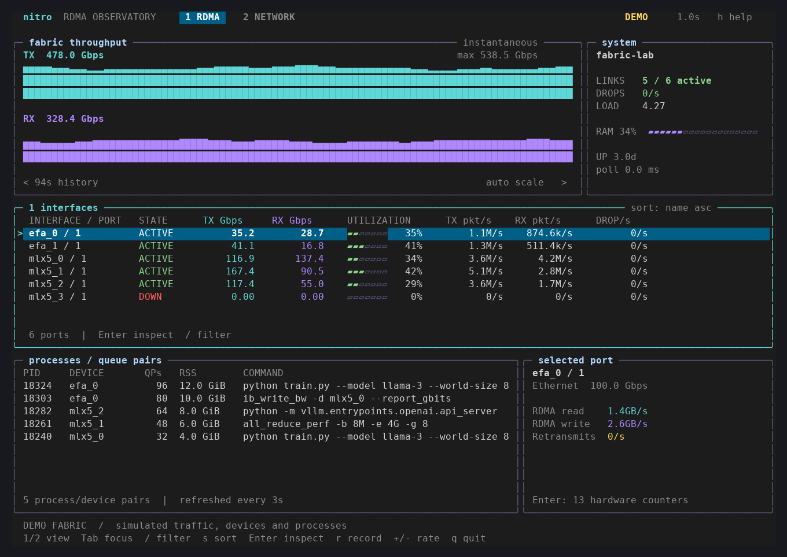

# nitro

A native C++20 RDMA monitor with a btop-inspired terminal interface. See what your
fabric is doing, inspect hardware counters, and find the processes owning its
queue pairs. Linux only; no Python runtime, RDMA userspace library, or external
command is needed by the application.



The screenshot uses `--demo`. Live mode never substitutes simulated data.

## Build and run

Dependencies: a C++20 compiler (GCC 11+ or Clang with a C++20 standard library),
CMake 3.21+, pkg-config, Linux UAPI headers, and wide-character ncurses. Ninja is
used by the supplied presets. Python 3 is needed only for CLI and terminal tests.

```sh
# Debian / Ubuntu
sudo apt install build-essential cmake ninja-build pkg-config libncurses-dev linux-libc-dev python3

cmake --preset release
cmake --build --preset release
ctest --preset release

./build/release/nitro          # real hardware
./build/release/nitro --demo   # explore without RDMA hardware
```

A plain CMake build works as well:

```sh
cmake -S . -B build/local -DCMAKE_BUILD_TYPE=Release
cmake --build build/local -j
cmake --install build/local --prefix "$HOME/.local"
```

Use a UTF-8 terminal at least **80 × 24**; **120 × 40** gives every panel room.
`--ascii` supports fonts or terminals without the graph glyphs. `--theme forest`
and `--theme mono` select alternative palettes. No network downloads happen
during configuration or compilation.

## What it monitors

- RDMA devices and ports, their logical state, link speed, TX/RX Gbps, packet
  rates, and full-duplex utilization (`max(TX, RX) / link speed`).
- Every exposed hardware counter: RDMA reads/writes, retransmits, drops, link
  events, congestion, and provider-specific counters in the inspector.
- Queue-pair ownership by **process and device**, with command, user, resident
  and virtual memory, state, nice value, and thread count.
- Ordinary network interface throughput in a separate view, plus host memory,
  load, uptime, and collection time.
- Streaming Perfetto / Chrome traces, long-form CSV, and NDJSON for scripts.

Discovery, hardware counters and queue pairs use Linux RDMA netlink. Sysfs adds
standard InfiniBand counters and provides a fallback when netlink statistics
aren't supported or accessible. EFA canonical counters, mlx5 standard counters,
and both erdma naming conventions are handled. Provider-specific availability
still depends on the kernel and driver. Nitro never changes driver settings,
resets counters, sends test traffic, or changes processes.

Run as your normal user first. Some kernels hide QP ownership or counters from
unprivileged callers. Press **w** to see collector diagnostics. Containers and
restricted namespaces may hide hardware or reject netlink. `--no-netlink` reads
sysfs only; process ownership is unavailable in that mode.

## Interaction

| Key | Action |
| --- | --- |
| `1`, `2` | RDMA / network view |
| `↑` / `↓`, `j` / `k` | Select a row; scroll counters |
| `PgUp`, `PgDn`, `Home`, `End` | Move through long lists |
| `Tab` | Focus interfaces / processes |
| `Enter` | Inspect counters or process details |
| `/` | Edit a filter; Enter applies, Esc cancels |
| `s`, `S` | Cycle interface sort / reverse order |
| `Space` | Pause display; collection and recording continue |
| `a` | Switch current values to a time-weighted 10-second average |
| `g` | Auto-scale / combined line-rate scale |
| `+`, `-` | Sample faster / slower, in 100 ms steps |
| `t` | Cycle midnight / forest / monochrome palette |
| `r` | Start / stop a Perfetto trace in the current directory |
| `w`, `h` | Diagnostics / help |
| `Esc` | Close inspector or clear filter |
| `q`, `Ctrl-C` | Quit, finalize recording, restore terminal |

Click tabs or rows to select; double-click a row to inspect; use the wheel to
scroll. Port selection follows device identity even when rate sorting reorders
rows. Filtering affects the visible aggregate graph. Graphs always show the
sampled history; `a` averages the numeric traffic values. Process rows are
sorted by QP count and refreshed every three seconds. On smaller terminals,
focus processes with Tab and use Enter for their inspector.

## Capture and scripting

```sh
# Two measured NDJSON samples from one device
nitro --json --count 2 --interval 500 --device mlx5_0

# Record a 30-second window, selecting a particular port and another device
nitro --duration 30 --interval 250 --device mlx5_0/1,efa_0 --record fabric.json

# Stream raw totals and measured rates; stop with Ctrl-C
nitro --headless --csv counters.csv

# Start the interactive dashboard with recording already enabled
nitro --record session.json

# Reproducible capture with no hardware
nitro --demo --count 10 --interval 100 --record demo.json --csv demo.csv
```

Headless mode writes one JSON object per line to stdout. Redirect to a file or
`/dev/null` when you only need a recording. `--json` defaults to one sample;
`--headless` continues until interrupted. `--count` and `--duration` imply
headless mode. A baseline is collected first; the first output follows one
sampling interval. A duration shorter than the interval can produce an empty
recording. Output paths are created exclusively: an existing file is an error.

Trace files open in [Perfetto](https://ui.perfetto.dev/). Each device/port has
separate TX/RX Gbps, packet-rate, and drop-rate tracks. CSV columns are
`timestamp_us,kind,device,port,counter,total,per_second,reset`. CSV exports all
counters, including canonical aliases. Timestamps in recordings are relative to
the start of recording; traces finalize on normal exit, SIGINT, SIGTERM, or
SIGHUP. SIGKILL or a full filesystem can leave an incomplete trace.

A displayed `--`, a JSON `null`, or a blank CSV rate means **unavailable**, not
zero. The first sample, newly appearing counters, reset/wrapped counters, and
unreadable counters do not generate artificial rate spikes. Standard IB
`port_xmit_data` / `port_rcv_data` totals retain their native four-byte-word
units; the `tx_bytes` / `rx_bytes` aliases convert them to bytes. Receive errors
are not relabeled as drops. Unknown drop totals remain unavailable.

## Development and validation

```sh
cmake --preset debug
cmake --build --preset debug
ctest --preset debug

cmake --preset sanitize
cmake --build --preset sanitize
ctest --preset sanitize

cmake --preset release -DNITRO_BUILD_BENCHMARKS=ON
cmake --build --preset release
./build/release/nitro_benchmark
```

Tests cover rates and resets, hotplug, sparse counters, per-port identity, clock
ordering, bounded histories, weighted averages, netlink framing and malformed
attributes, deterministic parser fuzzing, sysfs/procfs fixtures, trace/CSV
serialization, exclusive file creation, CLI validation, and background
recording. PTY integration tests launch the real TUI, exercise controls and
resizes, record traces, and verify restoration of terminal settings after quit
and SIGTERM. GCC and Clang builds plus ASan/UBSan run in CI.

See [CONTRIBUTING.md](CONTRIBUTING.md) for C++ conventions and
[architecture](docs/architecture.md) for collector and concurrency details.
See [local validation and measurements](docs/validation.md).
The benchmark measures the demo collector and metrics engine; it does not
measure NIC driver latency or establish performance parity with btop.